# Neon Lasertag

[](https://ko-fi.com/W7J0271P9Q)

Red vs Blue lasertag in procedurally generated neon arenas, for VR headsets (OpenXR) and the
flat screen. Built with Bevy.


## Getting started

Download a build for your platform from the releases page, or run from source:

```
cargo run --release                         # VR if a headset is available, else the flat screen
cargo run --release -- --flat               # flat screen
cargo run --release -- --seed 42 --bots 7   # straight into a match against bots
```

The start menu offers **Botmatch**, **Multiplayer** (Internet server list or LAN, join or host),
**Options** and **Quit**. Hosting an internet game tries to open UDP port 27420 on your router
(UPnP / NAT-PMP); if that fails, forward it by hand.

- **Windows:** use the MSI installer; it adds Start menu shortcuts for flat screen and VR.
- **macOS:** flat screen only. The build is unsigned, so run
  `xattr -dr com.apple.quarantine` on the unpacked folder before the first start.
- **Steam Frame:** copy the aarch64 AppImage to the Frame, `chmod +x` it, start SteamVR and
  run it (from the desktop or as a non-Steam game).

## How to play

Matches last 10 minutes. Score points for your team:

| Action | Points |
|---|---|
| Tag out an enemy (3 hits) | 100 |
| Hit the enemy team's target (Classic) or a secondary target (Megatarget) | 100 |
| Assist (your hit, a team mate's tag-out within 10 s) | 50 |
| Defend (tag-out near your own targets) | +25 |
| Megatarget, or carrying the enemy's prism home | 1000 |

In the last minute every point counts double.

- After a hit you're briefly immune and can't shoot. After respawning you're protected until
  you fire or the protection runs out.
- Your own spawn pads heal you and refill your blaster; the white reload stations in the
  middle refill it too.
- Pick your team in the Botmatch or host menu (or with `--team`), or let the game put you on
  the smaller one. During a match the in-game menu lets you change sides, unless the host set
  **Switch teams** to locked (`--lock-teams`); bots move over to keep the teams even.
  Infection hands out the sides itself.

### Game modes

Pick the mode in the Botmatch or host menu, or with `--mode`.

| Mode | Goal |
|---|---|
| **Megatarget** (default) | Open the sealed room in the middle and hit the megatarget. |
| **Classic** (`classic`) | Hit the enemy team's targets. |
| **Capture the Prism** (`prism`) | Steal the enemy's prism and carry it home. |
| **Infection** (`infection`) | Phantoms against survivors: survive, or infect everyone. |

**Megatarget.** The megatarget sits in a sealed room in the middle, behind forcefields that tag
out anyone who walks in. Charge up at both secondary targets at the arena's edges to pass the
forcefields for 60 s. Each secondary target has its own way of charging you, picked at random
per arena: shoot it, align its relays, solve its circuit or pattern, or shoot its lamps in
sequence (see [Puzzles and consoles](#puzzles-and-consoles); `--secondary` picks one for both).
In the room, the megatarget is dormant until you solve the console under it; then hit it. The
secondary targets are guarded by turrets; shoot the yellow target above a turret to switch it
off for 15 s.

**Classic.** Each team's targets hang under a roof deep in its half and can only be hit from
behind or from the level around them.

**Capture the Prism.** The classic arena without targets. Each team's prism hovers on the
ground under its first target's alcove. Touch the enemy's prism to take it and carry it to your
own prism's spot while yours is there: 1000 points. You can't fire while carrying it, but you
can throw it (the grenade input) for a team mate to catch. Tagged out, you drop it; it goes home
when its own team touches it or after 20 s on the floor.

**Infection.** The classic arena without targets. A quarter of the players start as Red
phantoms: always cloaked, they can't take pickups, and their bolts fly only 14 m but tag out at
once. Every Blue survivor they tag out comes back as a phantom. Survivors score 25 every 10 s
they're in the game; infecting everyone ends the match and gives the phantoms 1000.

### Arena features

- **Mirrors** bounce a bolt once, so you can bank shots around corners.
- **Jump pads** throw you up to the upper level.
- **Laser gates** switch on and off; walking through one while it's on counts as a hit.
- **Turret boxes** stand in each half: one in a small arena, two in a medium one, three in a
  large one. A turret is folded up inside each one,
  working for nobody (the box glows white). Solve the sliding puzzle on the box's side to make
  the turret work for your team: it rises out and shoots your enemies within reach, twice a
  second. Shoot it to switch it off for 10 s (not in its first 3 s out). The other team takes
  it over by solving the puzzle again. Every solve sets a new puzzle, and team mates can carry
  on with each other's work.

  **The puzzle:** click a piece to slide it into the square from its side. A piece stops where
  another one is in its way. Click it again to slide it back out, unless a piece you slid in
  later now blocks its way out. Fill the square to solve it. At least one piece is a key:
  slide it in too early and another piece can't get past it. On the flat screen, aim at a piece
  within reach and click; the blaster doesn't fire while you aim at a puzzle. In VR, touch a
  piece with the index finger of a hand without a gun and pull that hand's trigger.

  

### Puzzles and consoles

Puzzles glow on their own, so they stay readable in a blackout. On the flat screen you aim at a
puzzle within reach and click (the blaster holds fire). In VR you point with the index finger
of your free hand and pull that hand's trigger. Team mates can carry on with each other's work.

**Click puzzles**, on turret boxes, consoles, secondary targets and the megatarget's console:

| | |
|---|---|
| 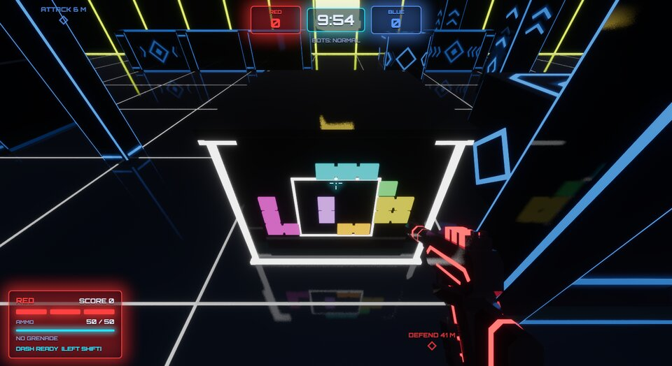 | **Sliding puzzle.** Click a piece to slide it into the square from its side, and click it again to slide it back out. Fill the square. One piece or more is a key: slide it in too early and another can't get past it. |
| 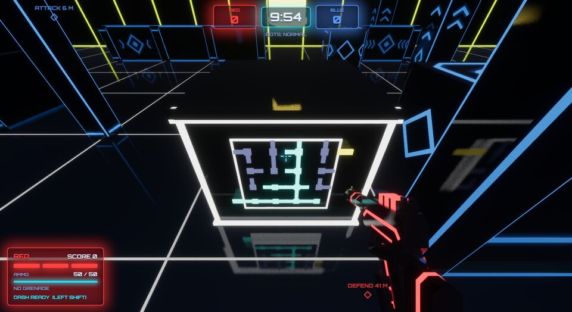 | **Circuit.** Click a tile to turn it a quarter turn. Connect the current from the cyan stub on the left to the yellow one on the right. Tiles with current glow. |
| 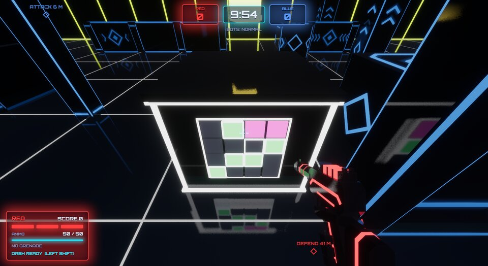 | **Pattern.** Click a light to switch it on or off. Light exactly the framed cells. A lit cell glows green when it's framed and pink when it isn't. |

**Shooting puzzles**, at secondary targets in Megatarget mode:

| | |
|---|---|
| 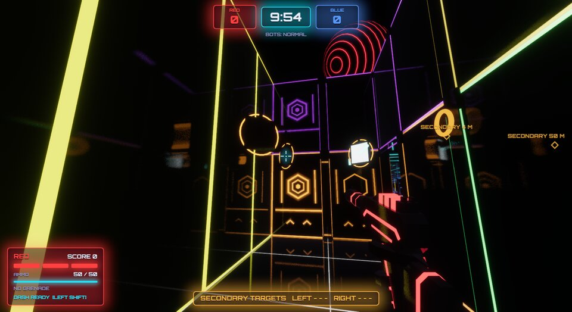 | **Relays.** Three mirrors hang over the pocket. Each shot turns a mirror a quarter turn, and anyone's shot counts, so enemies can put one out of line again. Line them all up (they turn cyan) so the beam reaches the receiver over the target. |
| 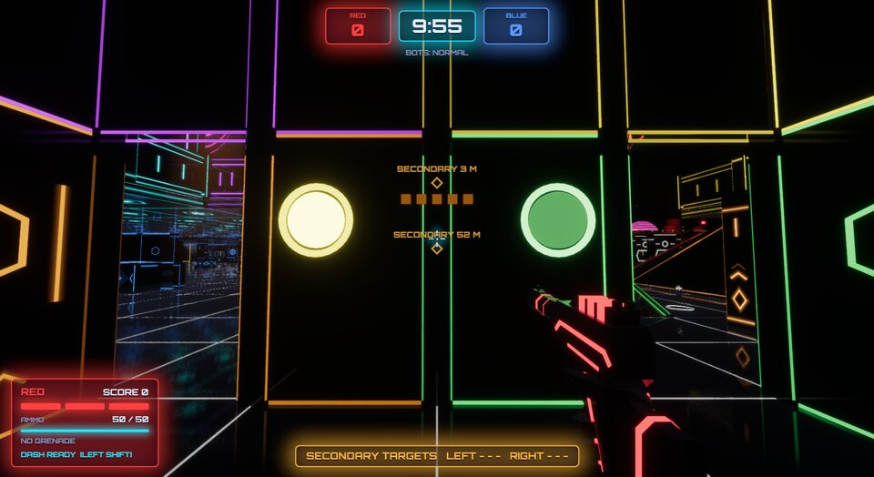 | **Sequence.** Four coloured lamps flash a sequence of five. Shoot them in that order. A lamp shot out of turn, by anyone, starts it over. The pips over the target count your progress. |

Solving a secondary target's puzzle, or shooting the last relay or lamp, charges you and your
team mates standing in that pocket.

**The megatarget's console.** It stands in the middle of the room under the megatarget. Only
players with the power, inside the room, can click it. Solving it energizes the megatarget for
you: it lights up and spins, and your hits count.

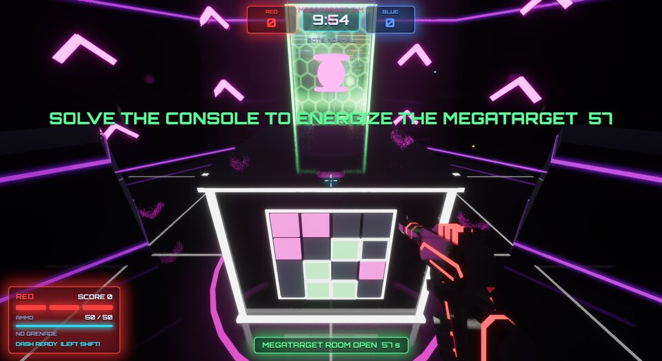

**Consoles** stand in each half of every mode: two kinds in a small arena, three in a medium one,
all five in a large one. Each shows a hologram of what it does over a click puzzle. Solve it
and it works for your team; the bars along its top fill while it resets.

| | |
|---|---|
| 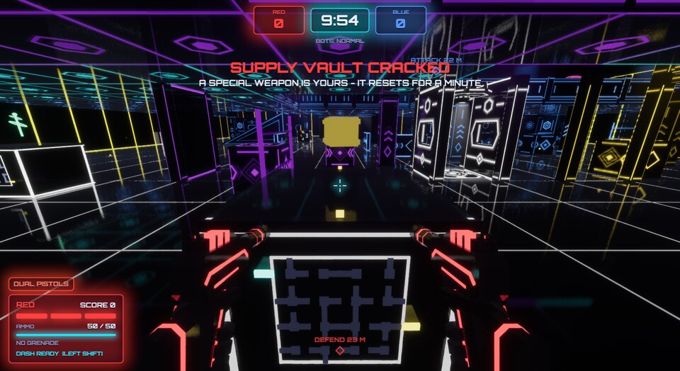 | **Supply vault.** Hands you a special weapon: shotgun, charge gun, ricochet rifle, prism lance or dual pistols. It then resets for a minute. |
| 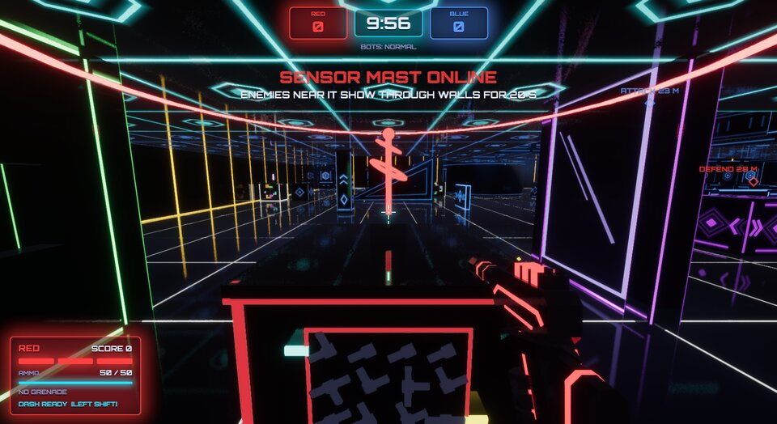 | **Sensor mast.** For 20 s, every 2 s, it shows your team the enemies within 18 m, through walls, and strips their cloaks. Nobody can switch it off or take it over until it's done. |
| 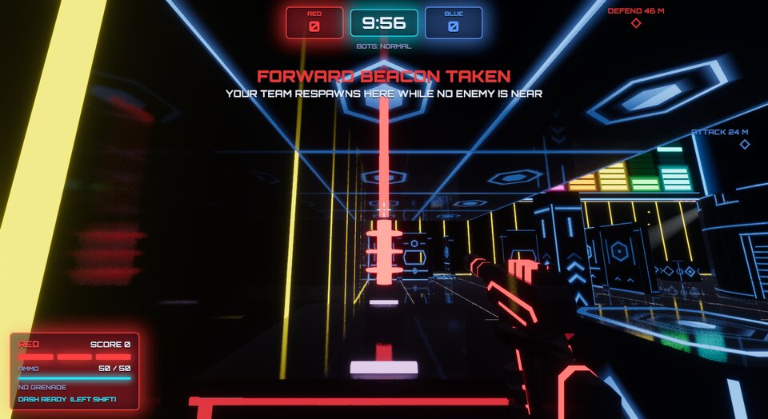 | **Forward beacon** (not in Infection). Your team respawns at it most of the time while no enemy is within 8 m. A column of light in your team's colour marks it. The other team takes it over by solving its puzzle. |
| 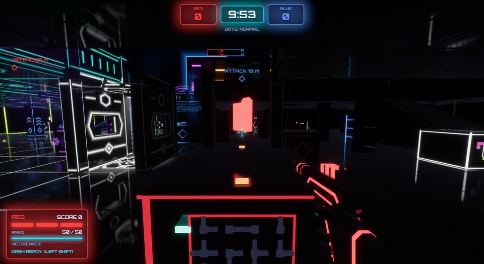 | **Blackout breaker.** The quarter of the arena it stands in goes dark for 20 s. Only shots, players, pickups and puzzles glow there, and bots see less far. |
| 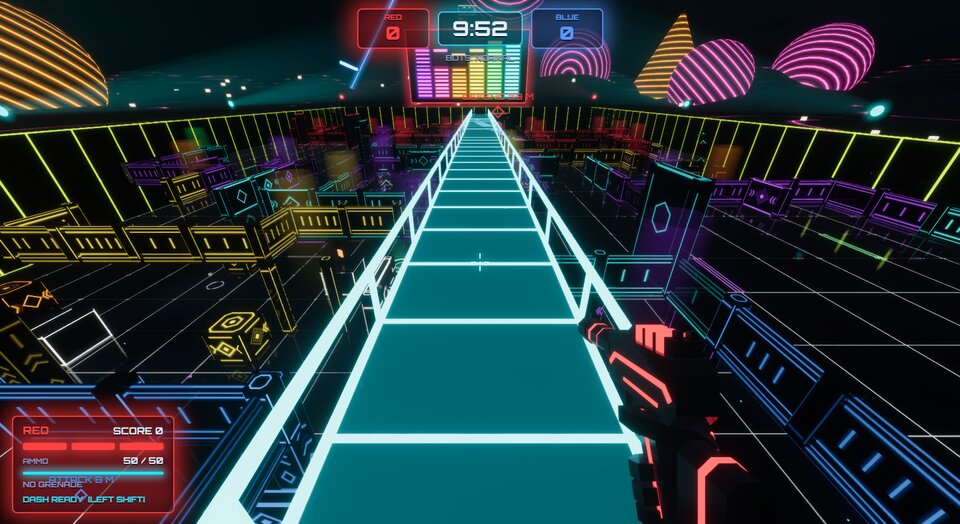 | **Light bridge.** For 25 s a hard-light walkway stands a storey above the upper floor, from your half across the middle to the other. Its ramps lead up from the upper floor, and its low rails let you shoot down over the arena. Anyone can use it, and whoever is on it when it fades falls. |

### Arena events

The first event strikes 2-3 minutes into a match, then another every 2-3 minutes, never the same
twice in a row and none in the last 75 s.

| Event | Effect |
|---|---|
| Blackout | The lights go out for 20 s; bolts, players, pickups and targets still glow, and bots see less far. |
| Overdrive | Every missing pickup comes back at once. |
| Mirror Storm | For 20 s every wall bounces bolts back (once). |
| Low Gravity | For 20 s everyone falls slower and jumps about three times as high. |
| Bounty | The top scorer is marked for everyone for 30 s: tagging them out is worth 300, and lasting it out pays them 300. |

### Pickups

Walk over a pickup to take it. Laser grenades have their own spots; every other spot rolls a
weapon, a gadget or a power each time it comes back. You hold one special weapon and carry one
gadget at a time, and a new one replaces the old. You lose everything you picked up when you're
tagged out.

**Laser grenade:** throw it; after 3 s it spins and fires bolts in all directions, hitting
everyone (including you).

#### Weapons

Each replaces your blaster until you're tagged out, and taking one fills it up.

| Weapon | Effect |
|---|---|
| Shotgun | 10 short-range bolts per shot. |
| Charge gun | Tap to fire a bolt; hold the trigger to charge a beam that pierces players and deals two hits. |
| Ricochet rifle | Slower-firing bolts that bounce off every wall up to 3 times (but not off targets). |
| Prism lance | A slow marksman rifle whose shot hits instantly; a head hit counts as two. Zoom with Z or the mouse wheel (VR: a laser sight). |
| Dual pistols | A pistol in each hand, sharing the shots. Flat screen: clicks fire them in turn. VR: grip the second with your free hand; while you hold both, the shield is on the left stick's click, the gadget on holding B / Y, a quick double jump dashes, and there are no grenades. |

#### Gadgets

Carried until you use it (the gadget input) or are tagged out.

| Gadget | Effect |
|---|---|
| Barrier | Put up a wall of light for 8 s that blocks enemy bolts but lets your team's through. |
| Mirror | Put up a mirror for 15 s that turns back every bolt, anyone's. |
| Pulse sensor | Throw it; it sticks where it lands and for 20 s marks every enemy within 10 m for your team, through walls and cloaks. |
| Decoy | Send a copy of yourself running ahead for 6 s; bots take it for you, and a bolt pops it. |
| Med beam | Hold the gadget input on a team mate within 8 m: it heals a hit every 2.5 s and refills their blaster (12 s of beam). |

#### Powers

| Power | Effect |
|---|---|
| Rapid fire | The blaster fires twice as fast. |
| Shield | Activate it (the shield input) to become immune to bolts for 10 s. |
| Cloak | Nearly invisible for 100 s; you flicker into view when you fire or are hit. |
| Speed boost | Run 50% faster for 15 s. |

### Controls

Flat-screen keys can be rebound in Options. The in-game menu shows the current bindings and a
summary of the rules.

| | VR | Flat screen |
|---|---|---|
| Move | Left stick, or walk in your room | WASD (Left Alt: walk) |
| Turn / look | Right stick, your head | Mouse |
| Jump | A or X | Space |
| Dash | Click the left stick | Left Shift or mouse button 4 |
| Crouch | Crouch, or pull the right stick down | Left Ctrl or C |
| Draw blaster | Grip at the holster on your hip | Always in hand |
| Fire | Trigger | Left mouse button |
| Grenade | Hold B / Y, throw, let go | Hold G or right mouse button, let go |
| Shield | Trigger of the free hand | Q |
| Gadget (barrier ...) | Grip of the free hand | E |
| Zoom (prism lance) | - | Z to toggle, or roll the mouse wheel up (down to stop) |
| Scores | In-game menu, or look at your wrist | Hold Tab |
| Menu | Menu button, or hold B / Y | Esc |

Seated VR players can use **Calibrate height** in Options to play at full height.

On the flat screen the floors, walls and players are glossy and mirror the neon (screen-space
reflections); on a weaker PC, turn **Reflections** off in Options.

## Command line options

| Option | Description |
|---|---|
| `--flat` | Start on the flat screen |
| `--vr` | Start in VR (any OpenXR headset) |
| `--gl-vr` | Start in VR with the foveated GL renderer (Steam Frame, Linux; needs `--features glvr`) |
| `--name NAME` | Your player name |
| `--seed N` | Arena seed; starts a match straight away |
| `--bots N` | Number of bots; starts a match straight away |
| `--difficulty easy\|normal\|hard` | Bot difficulty |
| `--arena small\|medium\|large\|random` | Arena size (`random` picks one per match) |
| `--mode classic\|megatarget\|prism\|infection` | Game mode (default `megatarget`) |
| `--secondary random\|shoot\|relay\|circuit\|pattern\|sequence` | Megatarget: how the secondary targets charge you (default `random`: each its own way) |
| `--team red\|blue\|auto` | Your team in local and hosted games (default `auto`: the smaller one) |
| `--lock-teams` | Local and hosted games: nobody changes sides during a match |
| `--match-time S` | Match length in seconds (local games) |
| `--host [PORT]` | Host a game on your network |
| `--public` | With `--host`: list the game on the internet |
| `--server-name NAME` | Name of the hosted game |
| `--connect HOST[:PORT]` | Join a game |
| `--left-handed` | VR: holster on the left hip |
| `--autopilot` | A bot plays for you (testing) |
| `--screenshot FILE --after T1,T2` | Save screenshots at the given times (s) |
| `--quit-after S` | Quit after S seconds |

Without `--flat`, `--vr` or `--gl-vr`, the game starts in VR when a headset is available and on
the flat screen otherwise.

## Development

```
cargo test --workspace                      # simulation, arena, transport, networking
cargo test -p lt-net --test portmap -- --ignored --nocapture   # test port mapping on this router
tools/models/build_all.sh                   # rebuild and check the models
tools/frame.sh                              # build, deploy to and launch on a Steam Frame
```

- Flat screen without a display: run inside a headless sway (`WLR_BACKENDS=headless`) with
  `--autopilot --screenshot shot.png --after 5,10`.
- VR without a headset: Monado's service with `XRT_COMPOSITOR_NULL=1` and `XR_RUNTIME_JSON`
  pointing at `openxr_monado-dev.json`; `LT_XR_SHOT=8` saves the eye images.

Debug environment variables:

| Variable | Effect |
|---|---|
| `LT_DEV="6:menu,10:play-hard,14:hit"` | Scripted actions at given times (see `dev_script` in `src/session.rs`) |
| `LT_CHASE=dist,height,deg` | Follow the local player from outside (angle from behind), showing its avatar |
| `LT_MENU=top\|botmatch\|multiplayer\|internet\|lan\|host-lan\|host-internet` | Open the start menu at that screen |
| `LT_MASTER=URL` | Use another master server |
| `LT_VR_MENU=1\|options` | Open the VR menu / options |
| `LT_SCORES=1` | Show the flat-screen scores |
| `LT_VR_FAKE_HANDS=1\|wrist\|scope` | Fake VR controllers (`scope`: the prism lance's scope held to the eye) |
| `LT_HOLSTER=x,y,z` | Holster position from the eyes (default `0.23,-0.58,-0.07`) |
| `LT_GUN_TILT=DEG` | Blaster tilt in the hand (default 30) |
| `LT_LEFT_HANDED=1` | Same as `--left-handed` |

### Builds and releases

CI (`.github/workflows/build.yml`) builds, tests and packages every push and pull request:
Linux x86_64/aarch64 tarballs and AppImages, a Windows zip and MSI, a macOS Apple silicon zip,
and the dedicated server (`lt-server`) and master server (`lt-master`) for Linux. `/build` in a
pull request comment replies with download links; pushing a `v*` tag publishes a GitHub
release.

The packaging scripts also run locally on Linux:

```
tools/openxr_loader.sh [--arch aarch64]          # the OpenXR loader, into target/openxr-ARCH
tools/appimage.sh --build                        # x86_64 AppImage into dist/
tools/appimage.sh --arch aarch64 --build         # Steam Frame AppImage, cross-compiled
tools/package.sh game x86_64-unknown-linux-gnu --loader target/openxr-x86_64   # tarball
```
